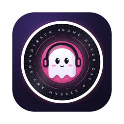
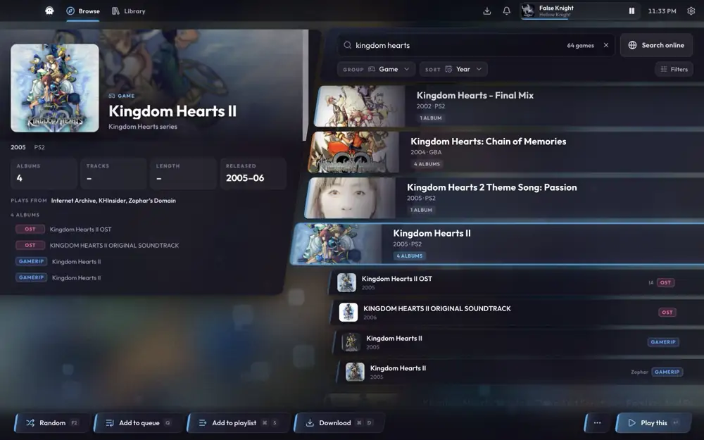
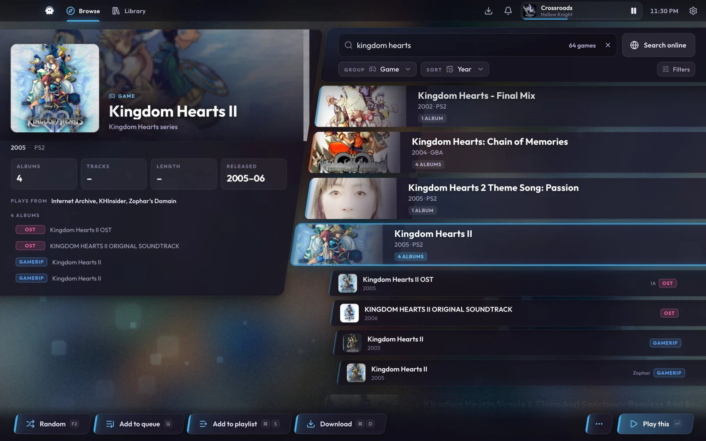
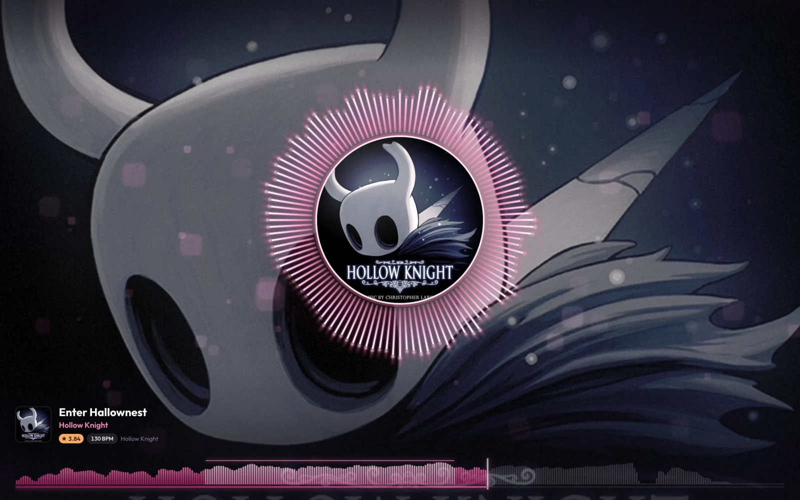
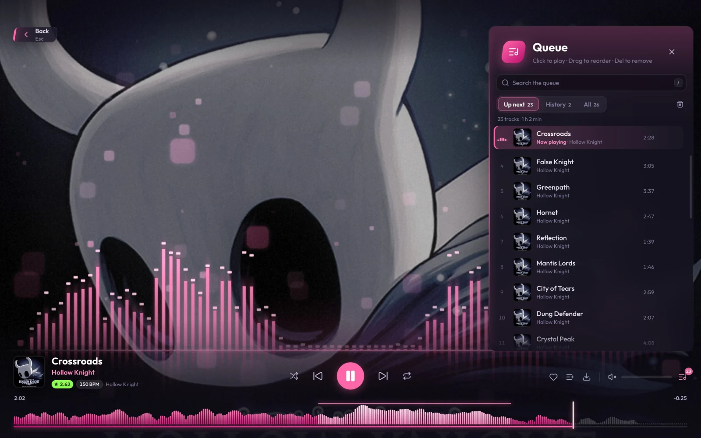
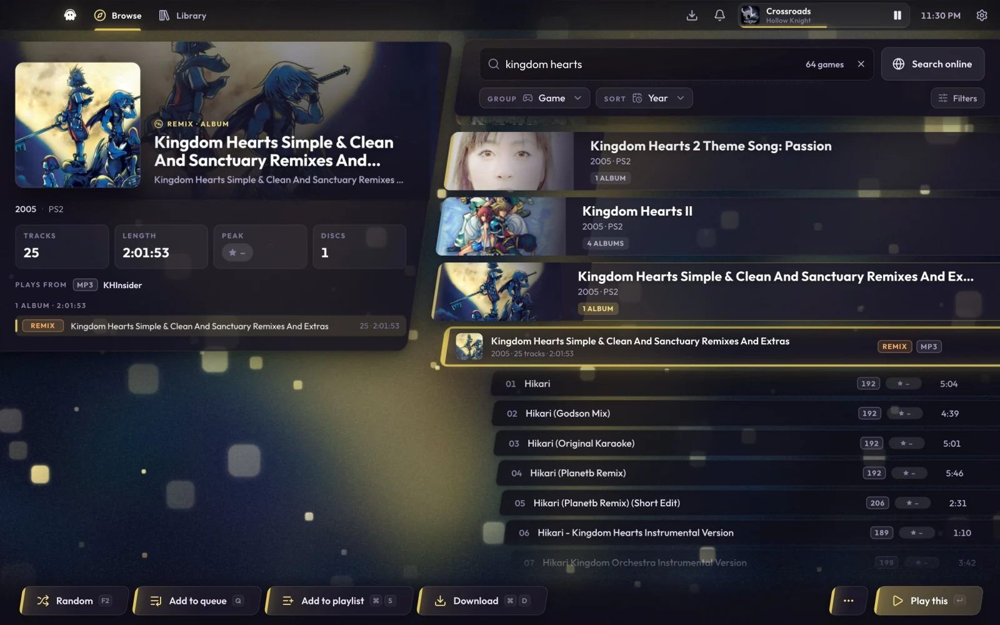
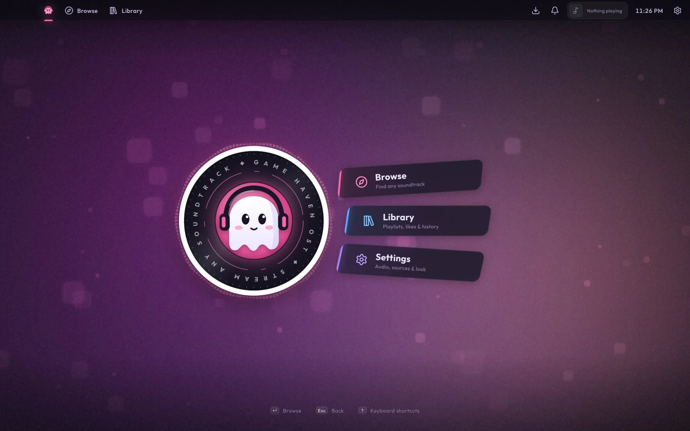
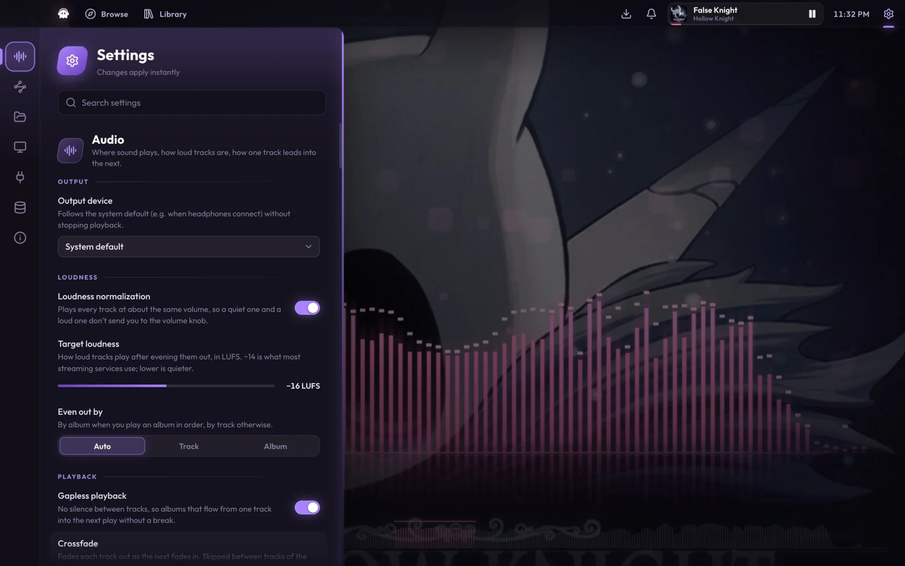

<div align="center">



# GHOST

**Game Haven OST. Stream the soundtrack of any video game.**

A desktop music player for game soundtracks, with an osu!-inspired interface that moves to the music.

[](https://github.com/nameless525/ghost/releases/latest)
[](https://github.com/nameless525/ghost/actions/workflows/ci.yml)
[](#install)
[](LICENSE)



</div>

## What it is

Type the name of a game and listen. GHOST builds a catalog of about **93,000 games** from public soundtrack archives on its first launch. It plays them through its own audio engine, with gapless playback, even loudness and real game loop points, and fills the screen with visuals that react to what you hear.

No account, no ads, no tracking. Everything GHOST knows lives on your computer.

## Features

- **A huge catalog, searched instantly.** KHInsider, Zophar's Domain, Modland, the Internet Archive's soundtrack collections and vgmrips chiptune packs, merged into one list of games. Search is forgiving: `ff7` finds Final Fantasy VII, `yugioh` finds Yu-Gi-Oh!, and typos get a "Did you mean…?".
- **Anything else, one click away.** If a soundtrack isn't in the catalog, **Search online** looks on YouTube, SoundCloud, Bandcamp and the Internet Archive and adds what you pick.
- **An engine made for game music.** Written in Rust: gapless playback, loudness levelling, optional crossfade, and real loop points. It emulates original chiptune files (SNES, NES, Game Boy, Mega Drive and more) live.
- **Visuals that follow the beat.** Three visualizers, beat-synced motion, a "kiai" glow on the most intense passages, and a BPM and intensity rating for each track you play.
- **Your library.** Queue (with search), playlists, smart playlists, likes, history, and downloads saved with full tags and cover art.
- **Keyboard first.** Every action has a key, the way osu!'s song select does. Press <kbd>?</kbd> anywhere to see them all.
- **Your own music too.** Add your music folders and they show up beside everything else.

## Screenshots

| | |
|:---:|:---:|
|  |  |
| **Browse** every game, album and track | **Play** with the radial visualizer |
|  |  |
| The **queue**, searchable, beside the skyline visualizer | Track lists with BPM and intensity |
|  |  |
| The **title screen** | **Settings**, explained in plain words |

## Install

Download the file for your computer from the **[latest release](https://github.com/nameless525/ghost/releases/latest)**.

| System | Download | Then |
|---|---|---|
| **macOS** (Apple Silicon) | `GHOST-…-mac-arm64.dmg` | Open it and drag GHOST into Applications. |
| **Windows** 10 and 11 | `GHOST-…-windows-x64-setup.exe` | Run it. GHOST installs and opens by itself. |
| **Linux** (Debian, Ubuntu, Mint…) | `GHOST-…-linux-amd64.deb` | `sudo apt install ./GHOST-*-linux-amd64.deb` |
| **Linux** (any other distribution) | `GHOST-…-linux-x86_64.AppImage` | `chmod +x GHOST-*.AppImage`, then run it. |

GHOST isn't signed with a paid developer certificate, so your system will ask once before the first launch:

- **macOS** says GHOST "can't be opened" or "is damaged". Run this once in Terminal, then open GHOST normally:
  ```bash
  xattr -cr /Applications/GHOST.app
  ```
- **Windows** SmartScreen says it "protected your PC". Click **More info**, then **Run anyway**.
- **Linux AppImage** needs FUSE 2. On Ubuntu 24.04 and later, install it with `sudo apt install libfuse2t64`, or use the `.deb` instead.

### Updates

From 0.4.0 on, GHOST checks for a new release once a day. It downloads it in the background ("Updating GHOST to 0.4.1"), checks it against its SHA-256 checksum, and installs it when you quit, or right away with **Restart to update** in the top bar. The first launch after an update shows what's new. Turn **Install updates automatically** off in Settings → About to be asked first instead.

The `.deb` package can't replace itself (that needs administrator rights): GHOST tells you when a release is out, and you install it the same way as before. The AppImage, the Windows installer and the Mac app in Applications update themselves.

Intel Macs, ARM Linux and other setups can [build from source](docs/DEVELOPMENT.md).

## Getting started

1. **Open GHOST and press any key.** The first launch builds your catalog in the background, which takes about ten minutes. You can browse and play right away while games keep appearing.
2. **Start typing** to search, or press <kbd>F2</kbd> for a random game. Use <kbd>↑</kbd> <kbd>↓</kbd> to move, <kbd>→</kbd> to open a game, and <kbd>Enter</kbd> to play.
3. **Can't find something?** Click **Search online** (or press <kbd>⌘</kbd>/<kbd>Ctrl</kbd> + <kbd>Enter</kbd>).

After that, the catalog keeps itself up to date quietly: it checks for new albums when GHOST starts and once a day while it's open.

### Optional: richer artwork

GHOST works fully without any accounts. If you'd like wide hero images, logos and extra game details, add free API keys in **Settings → Integrations**:

- **[SteamGridDB](https://www.steamgriddb.com/profile/preferences/api)**: hero backgrounds and logos.
- **[IGDB](https://api-docs.igdb.com/#account-creation)** (a free Twitch developer app): game details and cover art.

Keys are stored only in GHOST's settings file on your computer.

## Build from source

You'll need [Node.js 24+](https://nodejs.org), [Rust](https://rustup.rs) and a C/C++ compiler. Then:

```bash
git clone https://github.com/nameless525/ghost.git
cd ghost
npm ci
npm run build:native
npm run dev
```

[docs/DEVELOPMENT.md](docs/DEVELOPMENT.md) has the details for each OS, how to package an installer, and a tour of the code.

## How it works

| Layer | Built with |
|---|---|
| Interface | Electron, React 19, PixiJS for the background and visualizers, Web Animations for motion |
| Audio engine | Rust (symphonia, cpal, rubato) bound to Node with napi-rs, plus libgme, vgmstream and libopenmpt for game formats |
| Catalog | SQLite with full-text search, in a worker thread; one paced crawler per source |
| Live analysis | The engine publishes the spectrum and waveform to shared memory, which the interface reads every frame without any messaging |

The full design, from the audio signal chain to the motion rules, is in [docs/DESIGN.md](docs/DESIGN.md). What changed in each version is in the [CHANGELOG](CHANGELOG.md).

## Being a good guest

GHOST doesn't host or redistribute any music. It plays files that their sites already publish openly, and it tries hard to be polite to them:

- It reads each site one request at a time, with pauses, caches what it has read, and identifies itself honestly.
- It follows robots.txt. That's why joshw.info stays off unless you turn it on, and why SNESmusic isn't used at all.
- When a site shows a bot check, GHOST stops and waits instead of trying to get past it.

These archives are run by fans, often at their own expense. If you use one a lot, consider supporting it. And if you love a soundtrack, please buy it: that's what keeps composers making more.

## Acknowledgements

GHOST stands on the work of many others: the archivists behind [KHInsider](https://downloads.khinsider.com), [Zophar's Domain](https://www.zophar.net/music), [Modland](https://modland.com), [vgmrips](https://vgmrips.net) and the [Internet Archive](https://archive.org); the [game-music-emu](https://github.com/libgme/game-music-emu), [vgmstream](https://github.com/vgmstream/vgmstream), [libopenmpt](https://lib.openmpt.org), [symphonia](https://github.com/pdeljanov/Symphonia) and [yt-dlp](https://github.com/yt-dlp/yt-dlp) projects; and [osu!](https://osu.ppy.sh), whose song select inspired the interface. GHOST isn't affiliated with any of them.

## License

GHOST is released under the [MIT License](LICENSE). The decoder libraries in `native/vendor/` keep their own licenses (LGPL-2.1+ for libgme, BSD-3-Clause for libopenmpt, libogg and libvorbis, and ISC-style for vgmstream); see each library's folder.
